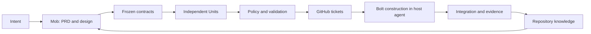

# MBUFlow

**Mob, Bolt & Unit workflows for AI agents.**

Plan independently. Build in parallel. Deliver with evidence.

MBUFlow turns product intent into PRDs, designs, frozen contracts and independent Units of
Work. Its portable `mbu-flow` skill guides the agent; an optional local helper validates
plans and creates GitHub Issues under an operator-approved policy.

> **0.1.0-alpha.1 — foundation, not a production orchestration service.**
> The helper does not spawn agents, execute arbitrary test commands, sync Jira/Projects,
> merge PRs or deploy. A valid plan is not proof that its code works independently.



## Install the skill

Once this branch is merged into the default branch:

```bash
npx skills add whale-devx/mbu-flow-skills --skill mbu-flow
```

For a branch checkout, install the local repository with `npx skills add . --skill mbu-flow`.
The skill lives entirely in `skills/mbu-flow/`; it does not import parent repository packages.
The installer command follows the upstream Skills CLI; end-to-end installation is a separate
compatibility check, not implied by the helper test suite.

Ask your agent:

> Use mbu-flow to inspect this repository, reuse its PRD/design documents, freeze contracts,
> split this feature into independent units and preview GitHub tickets. Do not change policy.

## Try the helper offline

Requires Python 3.11+. No model SDK or paid service is required for local checks.

```bash
python -m venv .venv
# macOS/Linux; on Windows use .venv\Scripts\activate
source .venv/bin/activate
python -m pip install -r skills/mbu-flow/scripts/requirements.txt
python skills/mbu-flow/scripts/mbu.py validate --root examples/independent-units
python skills/mbu-flow/scripts/mbu.py tickets --root examples/independent-units
python -m unittest discover -s tests -v
```

The example is a planning fixture, not completed application code. The preview makes no
network request and creates no issue. To scaffold a target project without overwriting docs:

```bash
python skills/mbu-flow/scripts/mbu.py init --root /path/to/project --profile backend --repository owner/repo
```

Use the installed skill's absolute path when calling it from another project. Profiles are
`minimal`, `backend`, `frontend` and `full`; generated documents remain **draft**.

## Autonomous ticket creation

Have an operator review the plan, enable `.mbu-flow/policy.yaml` and allowlist the exact
repository. Supply a scoped token as `MBUFLOW_GITHUB_TOKEN` through a trusted secret manager.
Then use `tickets --root /path/to/project --check` for read-only reconciliation and
`tickets --root /path/to/project --apply` for authorized creation.

The helper enforces declared ownership, contract digest, quotas, repository grants and
conservative duplicate checks. It journals uncertain writes and does not blindly retry them.
Existing human edits are never overwritten. Use one authoritative local writer per repo.
A locally editable policy is not an adversarial security boundary.

## What is implemented?

| Capability | This alpha |
| --- | --- |
| Mob / Bolt / Unit workflow | Portable instructions and reference guides |
| PRD, UX/UI, architecture, contracts, operations | Adaptive draft templates |
| Independent-unit planning | Host-agent workflow + static validator |
| GitHub Issues | Create-only adapter, preview, reconciliation and local journal |
| Knowledge | Markdown/Obsidian-compatible conventions + local lexical search |
| Parallel execution | Planning batches only; no dispatcher |
| Jira / GitHub Projects / bidirectional sync | Planned |
| Distributed recovery / exactly-once delivery | Not implemented |
| Cross-harness certification | Not yet verified |

See [PRD](docs/PRD.md), [architecture](docs/ARCHITECTURE.md),
[roadmap](docs/ROADMAP.md), [security](SECURITY.md), and [contributing](CONTRIBUTING.md).

## Naming and sources

Brand: **MBUFlow**. Skill: `mbu-flow`. Repository: `mbu-flow-skills`. Config: `.mbu-flow/`.
Inspired by AI-DLC concepts; not affiliated with or certified by AWS. The strict independence
rules are MBUFlow's design choices, not a claim that all AI-DLC implementations enforce them.

Format: [Agent Skills](https://agentskills.io/specification).
Installer: [Skills CLI](https://github.com/vercel-labs/skills).
Adapter: [GitHub Issues API](https://docs.github.com/en/rest/issues/issues).
Parser: [PyYAML](https://pyyaml.org/wiki/PyYAMLDocumentation).

Apache-2.0; see [LICENSE](LICENSE).
